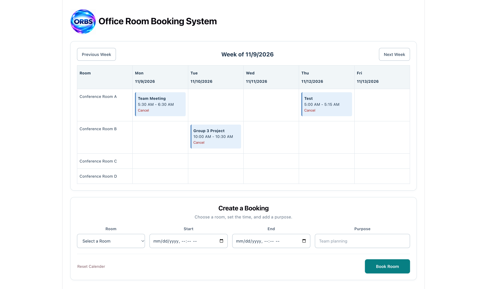

# O.R.B.S - Office Room Booking System

## Description

This project is to create an app that can reserve office rooms in a companies building. User will be able to reserve 1 of many rooms at a specific time and date, displayed on a weekly calender. There is also logic stop overlapping reservations. User can also cancel a reservation. You can also reset the entire calender.

## Table of contents

- [Mock-up](#Mock-up)
- [Usage](#Usage)
- [Contribution](#Contributing)
- [Questions](#Questions)
- [Diployment Links](#Questions)

## Mock-up

Landing Page

Reservation Page

## Usage

psql -U postgres

\i schema.sql

npm install

npm run seed

npm run dev

## Contributing

Steven Green

## Questions

GitHub Username: [mrgreen12375](https://github.com/mrgreen12375)

Email Address: [sbgreen.dev@gmail.com](sbgreen.dev@gmail.com)

## Deployment Links

Deploy Portfolio: https://orbs-d23fa61805ae.herokuapp.com/

GitHub Repo: https://github.com/mrgreen12375/orbs
